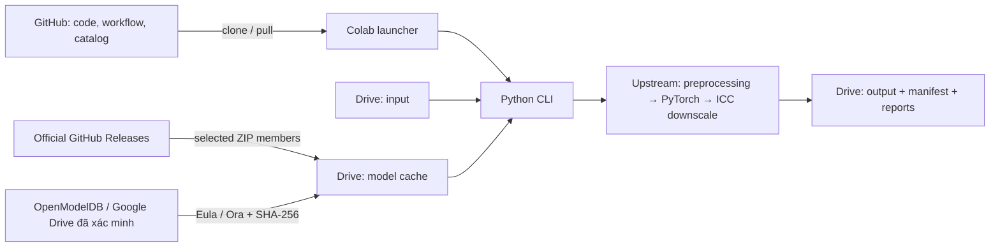

# MangaJaNai-Colab

[](https://colab.research.google.com/github/dex593/MangaJaNai-Colab/blob/main/colab/Run_MangaJaNai.ipynb)
[](https://github.com/dex593/MangaJaNai-Colab/actions/workflows/tests.yml)

Upscale thư mục manga trên Google Drive bằng **model thật và backend gốc MangaJaNaiConverterGui**. Có ba lựa chọn: **MangaJaNai tự động**, **Eula Digimanga BW V2 NC1**, **2x Manga Ora**. Tự tải model cần thiết, lưu kết quả an toàn và tiếp tục sau khi Colab ngắt phiên.

Repository public; notebook không dùng Colab Secrets, token hay đăng nhập GitHub.

**Môi trường hỗ trợ: Python 3.11–3.12.** `chainner_ext==0.3.10` của backend gốc chưa có wheel/binding hỗ trợ Python 3.13. Colab hiện có runtime 2026.07 dùng Python 3.12; hãy chọn runtime này. Script không âm thầm hạ Python hay thay PyTorch/CUDA. Khi Colab bỏ runtime này, cần kiểm chứng nâng native backend trước khi chuyển runtime mới.



## Bắt đầu trên Colab

1. Nhấn **Open in Colab**, chọn **Runtime → Change runtime type → GPU**, **Runtime Version: 2026.07 (Python 3.12)**. T4, L4 hoặc A100 đều được nếu Colab cấp GPU tương thích với PyTorch của runtime.
2. Tạo thư mục `MyDrive/Manga/Input`, chép ảnh vào đó. Thư mục con được giữ nguyên.
3. **Bước 1 — Chọn thư mục và cách Upscale:** nhập nơi chứa ảnh gốc, nơi lưu ảnh đã Upscale và số lần Upscale. Các ô đều dùng tiếng Việt có dấu. Chương trình đã có sẵn địa chỉ tải và tự chọn cách xử lý; bạn không cần điền nhánh, mã phiên bản hay thông số kỹ thuật. Bấm ▶ để áp dụng lựa chọn.
4. **Bước 2 — Kết nối Google Drive:** chọn tài khoản Google chứa ảnh và làm theo hướng dẫn cấp quyền trên màn hình.
5. **Bước 3 — Tải bản chương trình mới nhất:** bấm ▶ và chờ báo hoàn tất. Không cần tài khoản GitHub hay mật khẩu.
6. **Bước 4 — Chuẩn bị trước khi Upscale:** cài các thành phần cần thiết, kiểm tra card đồ họa và thư mục. Lần đầu có thể mất vài phút; chờ thông báo “Sẵn sàng”.
7. **Bước 5 — Bắt đầu Upscale:** xem số ảnh tìm thấy, ảnh bỏ qua, ảnh đang chạy và thời gian còn lại ước tính.
8. **Bước 6 — Xem kết quả:** ảnh nằm trong thư mục bạn chọn ở Bước 1. Nếu có lỗi, bảng kết quả sẽ ghi rõ ảnh nào và nguyên nhân.

Mỗi “bước” là một ô có nút ▶ ở bên trái trong notebook (còn gọi là cell). Chạy lần lượt, đợi bước trước xong rồi mới chạy bước sau.

| Ô cần điền ở Bước 1 | Cách chọn |
|---|---|
| Ảnh | Đường dẫn đến thư mục chứa ảnh gốc trên Drive, không phải link chia sẻ. Chương trình giữ nguyên ảnh gốc. |
| Lưu | Thư mục lưu ảnh đã Upscale, phải khác thư mục ảnh gốc. Chưa có thì chương trình tự tạo. |
| AI | Nơi giữ các tệp AI cần cho chương trình. Để trên Drive để lần sau không phải tải lại. |
| Bộ | Chọn **MangaJaNai (tự chọn)**, **Eula Digimanga BW V2 NC1** hoặc **2x Manga Ora**. |
| Upscale | `2` nghĩa là 1000 × 1500 thành 2000 × 3000. MangaJaNai/Eula hỗ trợ `1`–`4`, Ora hỗ trợ `1`–`2`; có thể nhập `1.5`. |
| Đuôi | Định dạng ảnh kết quả. Chọn `png` nếu chưa biết chọn gì. |
| Chạy | Mặc định **Chỉ Upscale ảnh chưa làm**: giữ kết quả đã hoàn tất. Chọn **Upscale lại tất cả ảnh** khi muốn làm lại và thay thế kết quả cũ. Chỉ chọn được một trong hai cách. |
| Thử | Bật để thử lại những ảnh bị lỗi ở lần trước, sau khi đã xử lý nguyên nhân. |
| Xem | Bật để chỉ xem danh sách, chưa chạy Upscale. |
| Hiện | Mức thông báo trên màn hình. Thường giữ **Thông thường** để thấy tiến độ và kết quả. |

Nếu chưa biết đường dẫn thư mục: sau khi kết nối Drive ở Bước 2, mở bảng **Files** bên trái → **drive → MyDrive**, bấm chuột phải vào thư mục → **Copy path**. Dán vào ô tương ứng ở Bước 1, bấm ▶ Bước 1 rồi chạy lại Bước 2.

**Khi thêm ảnh mới vào cùng thư mục:** đợi tải lên Drive xong rồi chạy lại **Bước 5**, sau đó **Bước 6**. Giữ **Chạy → Chỉ Upscale ảnh chưa làm**. Chương trình đọc lại ảnh cũ để kiểm tra kết quả, nhưng không chạy AI lại cho ảnh đã hoàn tất và còn hợp lệ. Ảnh thêm trong khi đang chạy sẽ được nhận ở lượt kế tiếp. Nếu thay đổi các ô ở Bước 1, nhớ chạy lại Bước 1 để áp dụng; nếu Colab bị đặt lại thì chạy lại cả sáu bước.

Bước 5 lưu dữ liệu còn chờ lên Drive rồi kết nối lại trước mỗi lượt, để xử lý tình trạng Colab vẫn thấy danh sách cũ khi bạn tải ảnh qua trang Google Drive. Nếu Google hỏi quyền kết nối lại, làm theo hướng dẫn trên màn hình. Không cần cài lại ở Bước 4. Nếu chưa lưu được dữ liệu lên Drive, chương trình dừng và báo lỗi, không ép kết nối lại. Việc kết nối lại ảnh hưởng tới toàn bộ Drive trong phiên Colab, vì vậy không chạy tác vụ khác đang ghi Drive cùng lúc. Cách xử lý này đã kiểm tra thứ tự gọi và các nhánh lỗi; chưa xác minh trên một phiên Drive thật.

Trong phần kỹ thuật bên dưới, `INPUT_DIR` tương ứng với ô **Ảnh**; `OUTPUT_DIR` là ô **Lưu** cộng thư mục riêng của Eula/Ora nếu chọn các bộ AI này. Lựa chọn **Chỉ Upscale ảnh chưa làm** bật `RESUME`, tắt `OVERWRITE`; lựa chọn **Upscale lại tất cả ảnh** làm ngược lại. Biểu mẫu không có hai ô bật/tắt độc lập cho hai cách này.

Khi logic thay đổi, sửa source trên GitHub rồi chạy lại cell 3–6. Không cần sửa processing code trong notebook.

**Cập nhật giao diện notebook:** một tab Colab đang mở không tự nhận thay đổi các ô từ GitHub. Khi có bản sửa giao diện, mở lại notebook bằng nút **Open in Colab**, hoặc chép các ô mới sang bản đang dùng. Cập nhật code xử lý bằng Bước 3 vẫn giữ nguyên cách hoạt động trên.

```python
INPUT_DIR = "/content/drive/MyDrive/Manga/Input"
OUTPUT_DIR = "/content/drive/MyDrive/Manga/Output"
MODEL_CACHE_DIR = "/content/drive/MyDrive/MangaJaNai/models"
UPSCALE_FACTOR = 2
OUTPUT_FORMAT = "png"
```

Chỉ xử lý ảnh PNG, JPG/JPEG, WebP, BMP và AVIF nếu libvips có decoder. Đọc bằng libvips, chuyển ICC sang sRGB giống upstream. Trong chế độ MangaJaNai tự chọn, nội dung ảnh quyết định model; extension chỉ dùng để tìm file. Tên Việt/Nhật/Unicode được hỗ trợ; thứ tự tự nhiên là `page2` trước `page10`.

## Ba bộ AI để chọn

| Chọn ở ô Bộ | Số lần Upscale | Cách xử lý |
|---|---|---|
| MangaJaNai (tự chọn) | 1–4 | Giữ workflow gốc: tự chọn MangaJaNai cho manga đen trắng và IllustrationJaNai V3 cho ảnh màu. |
| Eula Digimanga BW V2 NC1 | 1–4 | Model ESRGAN 4x, một kênh đen trắng. Ảnh màu được báo lỗi riêng; các ảnh đen trắng khác vẫn chạy. |
| 2x Manga Ora | 1–2 | Model DAT 2x cho manga; nhận ảnh một kênh hoặc RGB qua backend. Tác giả mô tả mục tiêu khôi phục screentone và giảm lỗi nén, chủ yếu cho trang rộng 650–900 px. |

Chọn bộ AI ở Bước 1 rồi chạy Bước 1 để áp dụng. Kết quả MangaJaNai giữ nguyên nơi lưu bạn đã chọn. Eula lưu ở thư mục con **Eula Digimanga**, Ora lưu ở **Manga Ora**. Mỗi nơi có tiến độ riêng, nên bạn có thể thử các bộ AI trên cùng bộ ảnh. Thư mục kết quả cũ có `.manga-colab` được loại khỏi lần quét sau nếu nằm trong thư mục ảnh gốc. CLI dùng chính đường dẫn `--output` được truyền vào; người dùng CLI chọn thư mục riêng theo ví dụ bên dưới.

Hai chế độ mới dùng đúng model đã chọn cho mọi kích thước trang, không dùng các mốc chiều cao của MangaJaNai. Không bật auto levels của MangaJaNai cho hai model này. Kích thước cuối nhỏ hơn hệ số model được xử lý bằng `final_target_resize` gốc, gồm ICC downscaling cho ảnh đen trắng. Ora không nhận yêu cầu trên 2x để tránh phải thay model hoặc Upscale lặp mà bạn không chọn.

**Model 4x có dùng để tạo ảnh 2x được không?** Có. Chọn Eula rồi đặt ô **Upscale = 2**: chương trình chạy AI 4x trước, sau đó giảm về kích thước 2x. Ví dụ ảnh 1000 × 1500 đi qua 4000 × 6000 rồi cho kết quả 2000 × 3000. Cách này đã được thử với Eula trên GPU thật; vẫn phải xử lý ảnh ở 4x và không đảm bảo đẹp hơn model 2x chuyên dụng.

Riêng Eula dùng bộ nhận diện `corrected` có sẵn để ảnh RGB chỉ chứa đen/trắng tuyệt đối vẫn được nhận đúng. Chế độ MangaJaNai mặc định giữ nguyên nhận diện upstream. Eula không tự chuyển ảnh màu sang đen trắng. Manga Ora nhận RGB nhưng được huấn luyện cho manga; với bìa màu, nên dùng chế độ MangaJaNai.

Nguồn mô tả và giấy phép: [Eula trên OpenModelDB](https://openmodeldb.info/models/4x-eula-digimanga-bw-v2-nc1), [Manga Ora trên OpenModelDB](https://openmodeldb.info/models/2x-Manga-Ora). Hai model đều ghi **CC-BY-NC-SA-4.0**; xem điều khoản từ nguồn trước khi dùng. Tác giả được ghi công: Eula và Ora/null.

## Auto model của MangaJaNai

Workflow được trích từ **`DEFAULT_WORKFLOW` trong `MainWindowViewModel.cs`** ở commit upstream `e63e7843ba45e2a2d9fd9007e3ea33aec9b9e222` (release GUI 1.5.1). File CLI mặc định của upstream còn dùng model màu V1 cũ, nên không dùng nó làm nguồn chain.

| Chiều cao ảnh nguồn grayscale | Family |
|---|---|
| ≤1250 | MangaJaNai 1200p V1 |
| 1251–1350 | MangaJaNai 1300p V1 |
| 1351–1450 | MangaJaNai 1400p V1 |
| 1451–1550 | MangaJaNai 1500p V1 |
| 1551–1760 | MangaJaNai 1600p V1 |
| 1761–1984 | MangaJaNai 1920p V1 |
| ≥1985 | MangaJaNai 2048p V1 |

Ảnh màu dùng **IllustrationJaNai V3denoise FDAT** `.safetensors`. Scale ≤2 chọn chain 2x; >2 chọn 4x. Tại đúng 2x, cả min/max cùng khớp nhưng chain 2x đứng trước nên thắng. Tất cả điều kiện và thứ tự nằm trong [workflow.json](manga_colab/data/workflow.json), filename/size/SHA-256 nằm trong [models.json](manga_colab/data/models.json).

Scale hỗ trợ từ **1 đến 4**, kể cả 1.5/2.5. Backend luôn chạy AI rồi dùng `final_target_resize` gốc để đạt kích thước cuối. Grayscale giữ auto levels và downscale với ICC Dot Gain 20% ↔ linear gamma; ảnh màu giữ Lanczos upstream. Không thêm sharpening, denoiser hoặc resize thay thế AI.

### Detector và các hành vi upstream cần biết

Mặc định `--detector upstream --threshold 12` giữ nguyên `cv_image_is_grayscale`, bao gồm:

- Một kênh luôn là grayscale.
- Trừ threshold khỏi chênh lệch các kênh và bỏ các pixel đen/trắng tuyệt đối khỏi mẫu số.
- **RGB chỉ gồm pixel đen/trắng tuyệt đối trả về color**; một kênh cùng nội dung trả grayscale.
- Tổng các chênh lệch `uint8` có thể tràn số và nhận sai một số màu.

`--detector corrected` là tùy chọn rõ ràng để sửa hai điểm cuối bằng cộng số thực và phân loại pure B/W là grayscale. Không tự động đổi hành vi mặc định. Một số ảnh grayscale hằng số có thể khiến auto levels gốc tạo NaN; project báo lỗi thay vì ghi một output giả thành công. Có thể dùng bản sao workflow JSON với `AutoAdjustLevels: false` cho trường hợp đó.

## Model downloader và cache

Nguồn cho chế độ MangaJaNai:

- [MangaJaNai V1 — release 1.0.0](https://github.com/the-database/MangaJaNai/releases/tag/1.0.0), asset `MangaJaNai_V1_ModelsOnly.zip`.
- [IllustrationJaNai V3 — release 3.0.0](https://github.com/the-database/MangaJaNai/releases/tag/3.0.0), asset `IllustrationJaNai_V3denoise.zip`.

Đã đọc archive thật, kiểm tra ZIP CRC và size, kiểm tra SHA-256 archive V3 được GitHub công bố, rồi ghi SHA-256 từng model vào catalog. Archive V1 không có digest trên Releases API; SHA-256 của bản đã tải được ghi rõ là checksum do project tính, không phải chữ ký của upstream.

Mỗi lần cần tải, downloader lấy asset qua **GitHub Releases API**, đối chiếu id/size/digest đã pin. HTTP Range + ZIP central directory cho phép chỉ tải member cần thiết, không tải tất cả 16 weights. Model đi qua `.part`, kiểm tra size/CRC/SHA-256, `fsync`, rồi atomic rename. Cache được hash trước khi dùng; file tải dở và file cùng tên nhưng sai checksum không được chấp nhận. Không có fallback resize.

Nếu API rate limit, server không hỗ trợ Range hoặc asset thay đổi, chương trình dừng và in đúng tên model, release, member ZIP và thư mục cài thủ công. Chỉ cần tải archive từ release chính thức, giải nén model được yêu cầu vào `MODEL_CACHE_DIR`, rồi chạy lại. Không cần token.

`scripts/build_catalog.py` dành cho maintainer: tải toàn bộ hai archive để kiểm chứng lại catalog. Người dùng bình thường không chạy script này.

### Tải Eula và Manga Ora

Chỉ tải model của bộ AI đang chọn, cache chung ở ô **AI**. Tệp được tải vào `.part`, kiểm tra dung lượng và SHA-256 theo OpenModelDB, rồi mới đổi sang tên chính thức trong cache. Có tiến độ theo số byte thực và thử lại khi mất mạng; không dùng tệp chưa hoàn tất. `gdown 6.4.2` xử lý liên kết Google Drive công khai, không đọc cookie đăng nhập, không dùng Colab Secrets hay token.

| Model | Tệp trong cache | Nguồn tải đã kiểm tra |
|---|---|---|
| Eula 4x | `4x-eula-digimanga-bw-v2-nc1.pth` · 67.010.885 bytes | [Tệp do OpenModelDB liên kết](https://objectstorage.us-phoenix-1.oraclecloud.com/n/ax6ygfvpvzka/b/open-modeldb-files/o/4x-eula-digimanga-bw-v2-nc1.pth) |
| Manga Ora 2x | `2x_Manga_Ora.pth` · 45.723.706 bytes | [Bản Google Drive do người dùng cung cấp](https://drive.google.com/file/d/1BWnJMFEGbP_uyMEnIruh5u6Xhy6Q0eV5/view), đã tải và khớp SHA-256 với OpenModelDB; không gọi đây là nguồn của tác giả. [Nguồn gốc được OpenModelDB dẫn tới](https://drive.proton.me/urls/S0NC2P0T8R#wo0OdPrwbKZO) |

Checksum và nguồn metadata được pin tại commit OpenModelDB `782aac088bd83dd3fc438a42eb0c3868dc559110`, trong [extra_models.json](manga_colab/data/extra_models.json). Nếu Google Drive hết lượt tải, liên kết bị xóa hoặc tệp thay đổi, chương trình báo lỗi kèm nguồn và nơi cài thủ công. Tải đúng tệp từ liên kết trên, lưu đúng tên vào thư mục AI rồi chạy lại Bước 5. Tệp khác checksum sẽ không được chấp nhận.

## Resume, an toàn dữ liệu và staging

- Manifest JSONL ghi và flush sau từng ảnh. Dòng cuối bị cắt khi mất kết nối được phục hồi; lỗi ở giữa manifest được báo rõ.
- Resume yêu cầu source SHA-256, cấu hình, workflow/model SHA-256, output path, kích thước, đọc đủ pixel và output SHA-256 đều khớp.
- Có trạng thái `prepared` để phục hồi nếu ngắt giữa lúc publish output và ghi `success`.
- File mới được ghi vào tên tạm; chỉ publish sau khi decode và xác minh. Output cuối được mở lại trước khi ghi success.
- Output tồn tại nhưng khác cấu hình, thiếu manifest hoặc bị corrupt **không bị ghi đè**. Chọn output mới hoặc bật `--overwrite`.
- `--retry-failed` thử lại ảnh đã lỗi; mặc định giữ lỗi cũ trong report và bỏ qua. `--overwrite` cũng cho phép chạy lại.
- Input không bị sửa. Không quét lại output/model cache/staging nằm trong input; không đi theo symlink.
- Các input trùng stem, như `page.jpg` và `page.png`, được thêm extension và hash ngắn vào tên output. Khi thêm/bớt input làm thay đổi nhóm xung đột, hãy kiểm tra plan trước khi tiếp tục.
- `--stage /content/manga-stage` xử lý từng ảnh trong local, kiểm tra dung lượng rồi đồng bộ output đã xác minh về Drive ngay sau ảnh đó. Không đợi hết batch mới sync.
- `Ctrl+C` giữ các ảnh thành công, dọn file tạm của ảnh đang chạy và trả exit code 130. Hard kill có thể để lại `.manga-*` hoặc `.part`; chúng không được coi là ảnh hoàn tất.

Drive là filesystem từ xa: `fsync` không đảm bảo dữ liệu đã tới máy chủ khi runtime mất điện; resume sẽ đọc/hash lại. Chỉ chạy **một runtime cho cùng output và model cache**; file lock không phải distributed lock giữa nhiều máy Colab. Dung lượng Drive hiển thị bởi filesystem có thể khác quota tài khoản; lỗi ghi dừng batch an toàn.

## CLI

Sau khi cài, dùng Python trong môi trường overlay:

```bash
PY=.venv-colab/bin/python
$PY -m manga_colab run \
  --input /content/drive/MyDrive/Manga/Input \
  --output /content/drive/MyDrive/Manga/Output \
  --models /content/drive/MyDrive/MangaJaNai/models \
  --scale 2 --format png --auto-model --resume

$PY -m manga_colab doctor --input /path/input --output /path/output --models /path/models --check-models
$PY -m manga_colab scan --input /path/input --output /path/output
$PY -m manga_colab models list --models /path/models
$PY -m manga_colab models download --input /path/input --models /path/models --scale 2
$PY -m manga_colab run --input /path/input --output /path/output --dry-run
$PY -m manga_colab run --config config/default.yaml --input /path/input --output /path/output --models /path/models
$PY -m manga_colab report --output /path/output
$PY -m manga_colab run --input /path/input --output /path/output/eula \
  --models /path/models --model eula-digimanga --scale 4 --resume
$PY -m manga_colab run --input /path/input --output /path/output/ora \
  --models /path/models --model manga-ora --scale 2 --resume
$PY -m manga_colab models download --input /path/input --models /path/models --model manga-ora
$PY -m manga_colab run --help
```

`--dry-run` và `scan` không tải model, không gọi GPU inference; có ghi `plan.json` trong output. `models list` dùng catalog local. `models download` quét ảnh để xác định weights cần tải. Mọi command đều có `--help`. Exit code: **0** hoàn tất, **2** lỗi/ảnh thất bại, **130** bị ngắt.

Các thiết lập thường dùng: `--tile 0` tự ước lượng, `--tile 256` giới hạn tile; `--precision auto|fp32`; `--cuda-device 0`; `--log-level quiet|normal|verbose|debug`; `--quality 95`; `--no-lossless` cho WebP. AVIF dùng quality, không nhận cờ lossless riêng vì giữ encoder upstream. Mặc định PNG lossless.

## GPU, hiệu suất và log

`doctor` hiển thị GPU, CUDA/PyTorch, VRAM free/total, compute capability, FP16/BF16, libvips/codecs/ICC, upstream pin, FDAT registry, quyền truy cập và disk. `--check-models` kiểm tra hash và load các weights đã có bằng Spandrel trên CPU; chưa có weights thì không chứng minh inference.

GUI index 0 là CPU, nhưng settings backend dùng danh sách accelerator bỏ CPU. Adapter ánh xạ cả hai danh sách và kiểm tra cuối cùng là đúng `cuda:N`. FP16 chỉ bật khi GPU phù hợp, Spandrel/upstream tiếp tục quyết định precision mà model hỗ trợ. Không tự đổi PyTorch hay CUDA của runtime.

Tile auto dùng estimator của upstream. Khi OOM, chạy lại ảnh với tile nhỏ hơn, giữ nguyên overlap/blending và postprocessing. Tile nhỏ có thể gây khác biệt số học/context của mạng; không cam kết bit-identical giữa các kích thước tile. Model cache giữ tối đa hai descriptor, chuyển model không hoạt động sang CPU để tránh chiếm VRAM; thứ tự ảnh vẫn là natural sorting.

Rich hiển thị bảng cấu hình, lượng model đã tải, tiến độ từng ảnh, thời gian còn lại ước tính và bảng kết quả. Trên Colab, chương trình truyền các bảng HTML qua subprocess rồi cập nhật tại chỗ; không dùng mã điều khiển con trỏ terminal trong notebook. Chỉ giữ tám thông báo gần nhất trên màn hình, không xóa log đầy đủ. Trên terminal vẫn dùng Rich trực tiếp.

Thông tin kỹ thuật của bộ xử lý nằm trong `backend.log`, hoạt động ứng dụng nằm trong `application.log`, bên trong thư mục `.manga-colab` tại nơi lưu kết quả. `report.json` và `report.csv` được cập nhật sau từng ảnh; bảng kết quả phân biệt thành công, lỗi, bỏ qua và chưa xử lý, đồng thời ghi nguyên nhân lỗi. Tốc độ trung bình tính số ảnh thành công trong cả lượt (gồm thời gian quét/tải/khởi tạo); tốc độ thanh xử lý chỉ tính thời gian xử lý. Ảnh bỏ qua không được tính vào tốc độ Upscale.

Bước cài đặt chỉ hiển thị bốn giai đoạn chính. Chi tiết nằm trong `/content/mangajanai-logs/setup.log`; nếu lỗi, phần cuối log hiện ngay trong notebook. Thông tin tải chương trình và kiểm tra máy nằm trong `source.log` và `doctor.log` cùng thư mục. Những file ở `/content` mất khi Colab cấp máy mới; log tiến độ trong thư mục kết quả trên Drive được giữ lại.

## Khắc phục lỗi

| Lỗi | Cách xử lý |
|---|---|
| Không có CUDA | Bật GPU, reconnect runtime, chạy lại cell 4. Không tự chuyển sang resize/CPU. |
| CUDA OOM kể cả tile nhỏ | Chọn GPU VRAM lớn hơn hoặc giảm tile; giới hạn tối thiểu 32. |
| Model unsupported/checksum sai | Xem tên model + release trong log, tải lại weights chính thức; chạy `doctor --check-models`. |
| GitHub rate limit/Range lỗi | Chờ rồi chạy lại hoặc cài đúng member ZIP thủ công. |
| Output đã tồn tại | Giữ nguyên cấu hình để resume; nếu cấu hình thay đổi, output mới hoặc `--overwrite`. |
| Ảnh hỏng/ICC không đọc được | Xem `plan.json`/backend log; ảnh khác vẫn tiếp tục. Giữ file nguồn để sửa riêng. |
| Drive mất mount/quota đầy | Mount lại hoặc giải phóng dung lượng, chạy `--resume --retry-failed`. |
| Vừa tải ảnh lên Drive nhưng số ảnh không tăng | Đợi trang Drive báo tải xong, chạy lại Bước 5 của notebook mới. Bước này tự kết nối lại Drive; kiểm tra đúng tài khoản và thư mục nếu vẫn thiếu ảnh. |
| `/content` thiếu dung lượng | Giải phóng các tệp tạm không còn cần trên Colab; giữ ảnh gốc trên Drive. Khi dùng CLI, có thể bỏ `--stage`. |
| Dependency conflict | Dùng runtime Colab mới; không cài lại torch tùy tiện. Gửi output doctor và backend.log khi báo lỗi. |
| `git pull --ff-only` không được | Branch bị phân kỳ hoặc source local đã sửa; lưu thay đổi rồi dùng runtime sạch. Không force/reset tự động. |

## Kiểm thử và giới hạn xác minh

Xem [docs/VALIDATION.md](docs/VALIDATION.md) cho môi trường và kết quả thực tế. Unit tests có test doubles để kiểm tra điều phối; chúng **không được tính là inference AI**. Smoke test thật là script riêng và yêu cầu CUDA + weights chính thức:

```bash
python -m pip install -e '.[test]'
python -m pytest -q
python -m ruff check manga_colab tests scripts
python scripts/smoke_test.py --scale 2
python scripts/smoke_test.py --scale 3
```

Không có web server, Gradio, xử lý archive manga CBZ/CBR hay multi-GPU scheduler trong bản này. Chức năng chính là batch ảnh trong thư mục. Notebook không chứa engine. Metadata EXIF/ICC gốc không được copy sang output ngoài hành vi lưu ảnh của upstream.

## Giấy phép và upstream

Code của project là **GPL-3.0-only**, xem [LICENSE](LICENSE). Hai hàm thuần cho detector/chain được chép từ upstream và ghi provenance trong file; inference không vendor. Backend tải đúng commit đã pin; các sửa đổi được ghi ở [docs/UPSTREAM.md](docs/UPSTREAM.md). Repository model MangaJaNai công bố [CC BY-NC 4.0](https://github.com/the-database/MangaJaNai/blob/main/LICENSE), có điều kiện ghi công và phi thương mại; kiểm tra thêm điều khoản từng release trước khi dùng. Eula và Manga Ora dùng **CC-BY-NC-SA-4.0** theo nguồn đã dẫn ở phần chọn bộ AI. Giấy phép code không thay giấy phép weights. Không commit weights, ảnh input/output, Drive, token hoặc cache vào repo.
